# Workflow Flow

[Português (Brasil)](../fluxo-workflows.md) · [English](fluxo-workflows.md) · [Español](../es/fluxo-workflows.md)

## Scope and Status

Review of local code on 2026-11-03, not verification of live GitHub configuration.
This guide supplements the [managed strategy](../estrategia-de-release.md) and
[CI/CD contract](../../.github/CI-CD.md); it does not change those contracts.
Guards were implemented in the catalog and applied locally through managed update.
The [integrity contract](release-integrity.md) documents interfaces, recovery,
migration and limits. Remote activation requires merging these changes.
Brazilian Portuguese is normative.
The new `distribution` gate still requires merging the workflows and configuring
reviewers on GitHub; local file updates do not activate it.

## Implemented Flow

**Legend:** blue/rectangle = automatic; yellow/parallelogram = manual action;
pink/diamond = human review or approval; green/cylinder = artifact or published state.
Arrows show the success path: without approval, the next stage does not start.
Dashed frames identify the **approval job's GitHub Environment**, not separate
branches or servers. The same Environment may appear in multiple phases.
Steps outside these frames do not automatically inherit an Environment; initial
CI and review jobs do not declare `environment`.

```mermaid
flowchart TD
  subgraph INTEGRATION["1. Integration"]
    PR[/"Open regular PR: feat, fix, docs and others"/] --> CI["ci.yml: hygiene, Gitleaks, build, tests, AOT"]
    CI --> RESULT["Green Result and up-to-date base"]
    RESULT --> REVIEW{"Human PR review"}
    REVIEW --> MERGE[/"Squash merge into main"/]
    MERGE --> MAINCI["ci.yml on main SHA"]
    MERGE --> RP["release-please creates or updates Release PR"]
    RP --> RPCI["Release PR CI: includes Preview gate"]
  end

  subgraph CANDIDATE["2. Candidate and Acceptance"]
    RP --> MANUAL[/"Run workflow: Release preview on main"/]
    MANUAL --> RESOLVE["Resolve version, dependencies, current HEAD and green CI"]
    MAINCI --> RESOLVE
    subgraph ENV_RC_TAG["Environment: release | RC tag"]
      RELRC{"Approve RC tag creation"}
    end
    RESOLVE --> RELRC
    RELRC --> RCTAG["Revalidate source; GitHub App creates tag and draft"]
    RCTAG --> RCREF[("vX.Y.Z-rc.N: draft prerelease")]
    RCREF --> RCCTX["Validate tag version and ancestry"]
    subgraph ENV_RC_DISTRIBUTION["Environment: distribution | RC"]
      DISTRC{"Authorize public RC distribution"}
    end
    RCCTX --> DISTRC
    DISTRC --> PUB["publish.yml: build 6 RIDs, smoke, installers, SBOM"]
    subgraph ENV_RC_ASSETS["Environment: release | RC assets"]
      RCASSETAPP{"Approve RC asset upload"}
    end
    PUB --> RCASSETAPP
    RCASSETAPP --> ASSETS["Attest and attach assets; create manifest; finalize RC"]
    ASSETS --> RCFINAL[("Public attested RC, no Latest")]
    RCFINAL --> Q["Dispatch Deploy on tag; quality guard"]
    Q --> TESTRC[/"Download and manually test RC package"/]
    subgraph ENV_RC_QUALITY["Environment: quality | RC acceptance"]
      QA{"Accept tested candidate"}
    end
    TESTRC --> QA
    QA --> QS["Verify assets and run linux-x64 smoke in containers"]
    QS --> ACCEPT[("preview-acceptance.json")]
    ACCEPT --> REFRESH["Rerun Release PR CI"]
    REFRESH --> RPCI
  end

  subgraph RELEASE["3. Stable Release"]
    RPCI --> RPOK["Green Preview gate and Result"]
    RPOK --> RPREVIEW{"Human Release PR review"}
    RPREVIEW --> RPMERGE[/"Squash merge Release PR into main"/]
    RPMERGE --> FINALCI["Run CI on merged SHA"]
    FINALCI --> RESUME[/"If needed, resume Release on main: mode=release"/]
    RPMERGE --> FINALGUARD["Pre-tag guard: current SHA, green CI and accepted RC code"]
    RESUME --> FINALGUARD
    FINALGUARD --> FINALTAG["GitHub App creates final tag and draft"]
    FINALTAG --> FINALREF[("vX.Y.Z: draft release")]
    FINALREF --> FINALCTX["Validate tag versions and ancestry"]
    subgraph ENV_STABLE_DISTRIBUTION["Environment: distribution | stable"]
      DISTFINAL{"Authorize public stable distribution"}
    end
    FINALCTX --> DISTFINAL
    DISTFINAL --> FINALBUILD["Build, smoke and SBOM of authorized tag"]
    subgraph ENV_STABLE_RELEASE["Environment: release | stable assets"]
      FINALAPP{"Approve asset publication"}
    end
    FINALBUILD --> FINALAPP
    FINALAPP --> FINALPUB["Revalidate source; attest assets and manifest; publish"]
    FINALPUB --> STABLE[("Public stable release")]
  end

  subgraph DISTRIBUTION["4. Distribution and Verification"]
    STABLE --> POST["post-release.yml"]
    subgraph ENV_HOMEBREW["Environment: release | Homebrew"]
      BREWAPP{"Approve tap update"}
    end
    POST --> BREWAPP
    BREWAPP --> BREW["Update tap and verify installation"]
    POST --> WINGETCHECK["winget.yml: validate package"]
    subgraph ENV_WINGET["Environment: winget"]
      WINGETAPP{"Approve winget submission"}
    end
    WINGETCHECK --> WINGETAPP
    WINGETAPP --> WINGET["Submit to winget-pkgs; await external moderation"]
    STABLE --> AUTOQ["Auto-dispatch Deploy to quality; guard"]
    subgraph ENV_STABLE_QUALITY["Environment: quality | stable"]
      STABLEQA{"Approve stable verification"}
    end
    AUTOQ --> STABLEQA
    STABLEQA --> VERIFYQ["Verify assets and run smoke"]
    STABLE --> PROD[/"Run workflow: Deploy on stable tag, production"/]
    PROD --> PRODGUARD["Production guard"]
    subgraph ENV_PRODUCTION["Environment: production"]
      PRODAPP{"Approve production verification"}
    end
    PRODGUARD --> PRODAPP
    PRODAPP --> VERIFYPROD["Verify assets and run smoke"]
  end

  classDef automatic fill:#e8f1fb,stroke:#1d4ed8,color:#102a43
  classDef manual fill:#fff4cc,stroke:#966800,color:#3d2c00
  classDef approval fill:#ffe4e6,stroke:#be123c,color:#4c0519
  classDef artifact fill:#e7f6ec,stroke:#15803d,color:#12351e
  class CI,RESULT,MAINCI,RP,RPCI,RESOLVE,RCTAG,RCCTX,PUB,ASSETS,Q,QS,REFRESH,RPOK,FINALCI,FINALGUARD,FINALTAG,FINALCTX,FINALBUILD,FINALPUB,POST,BREW,WINGETCHECK,WINGET,AUTOQ,VERIFYQ,PRODGUARD,VERIFYPROD automatic
  class PR,MERGE,MANUAL,TESTRC,RPMERGE,RESUME,PROD manual
  class REVIEW,RELRC,DISTRC,RCASSETAPP,QA,RPREVIEW,DISTFINAL,FINALAPP,BREWAPP,WINGETAPP,STABLEQA,PRODAPP approval
  class RCREF,RCFINAL,ACCEPT,FINALREF,STABLE artifact
  style ENV_RC_TAG fill:#303030,stroke:#111111,stroke-width:2px,color:#ffffff,stroke-dasharray:5 5
  style ENV_RC_DISTRIBUTION fill:#303030,stroke:#111111,stroke-width:2px,color:#ffffff,stroke-dasharray:5 5
  style ENV_RC_ASSETS fill:#303030,stroke:#111111,stroke-width:2px,color:#ffffff,stroke-dasharray:5 5
  style ENV_RC_QUALITY fill:#303030,stroke:#111111,stroke-width:2px,color:#ffffff,stroke-dasharray:5 5
  style ENV_STABLE_DISTRIBUTION fill:#303030,stroke:#111111,stroke-width:2px,color:#ffffff,stroke-dasharray:5 5
  style ENV_STABLE_RELEASE fill:#303030,stroke:#111111,stroke-width:2px,color:#ffffff,stroke-dasharray:5 5
  style ENV_HOMEBREW fill:#303030,stroke:#111111,stroke-width:2px,color:#ffffff,stroke-dasharray:5 5
  style ENV_WINGET fill:#303030,stroke:#111111,stroke-width:2px,color:#ffffff,stroke-dasharray:5 5
  style ENV_STABLE_QUALITY fill:#303030,stroke:#111111,stroke-width:2px,color:#ffffff,stroke-dasharray:5 5
  style ENV_PRODUCTION fill:#303030,stroke:#111111,stroke-width:2px,color:#ffffff,stroke-dasharray:5 5
```

Environment approvals happen under **Actions > run > Review deployments**, not in
the PR merge button. The same Environment may request approval in multiple jobs;
approving a PR does not replace accepting its RC in `quality`.
`distribution` authorizes disclosure of the version and SHA shown in the job,
before any public package in this flow. `release` supplies publication credentials;
neither approval replaces the other. The guard requires human review evidence in
the same run, including RC, manual preview and republish; an unprotected environment
cannot release packages. Source and CI are revalidated after waiting. Tags and
drafts may precede authorization, but packages are not distributed publicly.

Main CI and release-please start from the same push, but there is no cross-workflow
`needs` dependency. The diagram does not imply that main CI finishes before
candidate resolution. Preview gate allows the auditable waiver described in the
strategy; regular PRs, including fixes, do not require this gate.

Human approval in `quality` must represent manual package testing: the Environment
wait occurs **before** asset verification and automated smoke. Subsequent success
records acceptance; smoke does not replace human graphical testing.

Stable packages are rebuilt from the final tag, not promoted by reusing RC binaries.
The strategy requires equivalent code, with only release metadata differences.
`production` **does not gate public publication or distribution**: both have
already started when that manual flow runs. PixelPointer has no deployed server;
deployment verifies published packages.

## Other Paths

| Entry | Path and outcome | Environments |
| --- | --- | --- |
| `publish.yml`, dispatch on `main` with preview | Build and validation; creates `vX.Y.Z-preview.N` and GitHub Pre-release without Latest; neither promotable nor deployable | `distribution`, `release` |
| `publish.yml`, PR changing release chain | Build, smoke and installers; no tag or publication | None |
| `gw-release.yml`, dispatch on tag with `mode=republish` | Validates tag and existing release; requires authorization for missing artifacts, finalizes and reruns distribution; no new version or auto-deploy | `distribution`, `release`, `winget` for submission |
| `gw-deploy.yml`, historical tag dispatch | Redeploy/rollback using the same guard and smoke; respects `rollbackMinimumVersion`; no recreated tag or release | `quality` or `production` |
| `winget.yml`, dispatch | Validates supplied version; optional, idempotent submission | `winget` if submitting |
| `scheduled-smoke.yml`, Monday 09:00 UTC or dispatch | Rebuilds and tests AOT/packages; no publication | None |
| `gw-gitleaks.yml` | Called by CI; also accepts dispatch; scanning without publication | None |
| `gw-pr-hygiene.yml` | Called by CI: title, actionlint, managed files and Release PR Preview gate | None |
| `gw-github-assets.yml` | Called by publisher: digest-based immutable uploads and provenance | `release` |
| `gw-dotnet.yml`, `gw-node.yml` | Available reusable workflows; not called by current project CI | None in this flow |

`publishSnapshots: true` enables manual preview, but current CI does not call
automatic snapshot publication on each push. The `preview` Environment mentioned
in the strategy is absent from the local Environment policy. `winget` is referenced
by its workflow but is also absent from that policy. Their actual existence and
protections on GitHub have not been verified.

## Corrected Gaps

These items describe behavior before the guards introduced in this change.

- RC resolution compares the Release PR base to dispatch `github.sha`; it does
  not reread remote HEAD immediately before tag creation after `release` approval.
- `Assert-ReleaseTag.ps1` requires ancestry, not equality with current HEAD.
  This is appropriate for historical tags but insufficient for a fresh RC guarantee.
- An open feature PR is not detected as an RC dependency. A package can correctly
  match `main` yet lack the change the operator expected to test.
- Release-please creates the final tag before context and publication checks.
  A publisher-only gate cannot prevent tag/draft creation.

## Integrity Controls

The plan below was implemented **in the Groundwork catalog** and applied locally.
`Get-PreviewVersion.ps1`, `Assert-PreviewGate.ps1`, `Assert-ReleaseSource.ps1` and
publishers execute the guards. The literal marker
`Release-Depends-On: #123, #456` in the Release PR body supplements the durable
`releaseDependencies` array in `.github/ci-cd.json`. Open PRs do not imply
dependencies; verify preservation when release-please regenerates notes. The
points below record policy; the linked contract details its limits.

1. Pin candidate identity: main SHA, Release PR SHA/base, version and expected
   dependencies. Reread remote HEAD after approval and before tag creation;
   require the same base and green `Result` on the exact main SHA. Pending CI,
   a changed base or inconclusive queries must reject, never reuse stale data.
2. Do not block on every open PR. If a candidate must contain a specific PR,
   declare that dependency explicitly in the Release PR scope, using a validated
  format validated by the catalog. Require merge into main and inclusion of the
   resulting commit, accounting for squash; closing without merging is insufficient.
3. Regular fixes remain mergeable through normal CI. After integrating code changes,
   update the Release PR and generate/accept `rc.N+1`; never reuse acceptance for
   previous code. Show pending PR, expected/current SHA and recovery action.
4. Before merging the Release PR, require acceptance matching the current base and
   a diff restricted to allowed files. Before creating the final tag, revalidate
   the merged Release PR commit and code equivalence with the candidate; do not
   require literal RC/final SHA equality, since the bump produces another commit.
5. Main changes during publication approval must reject new releases and require
   fresh resolution. Keep republish/redeploy/rollback separate: immutable historical
   tags must not be required to track current HEAD.
6. An emergency waiver may skip RC acceptance with an auditable reason, but must
   never authorize stale source, missing mandatory dependencies or failing CI.

Primary discriminating test: resolve at SHA A, advance main to B during approval,
and reject **before** creating a tag or draft. Also cover pending/squash-merged
dependencies, pending/failing CI, a fix followed by a new RC, RC/final code
differences and permitted historical republish/rollback.

## Validation and Next Step

Local container tests cover source/CI, dependencies, RC/final differences and
preview without improper mutations. No tags/releases were created, workflows
dispatched, policies applied or remote checks/protections verified. Managed files
came from catalog update; seeds and customization were preserved. The diagram
shows functional stages; guards now precede tags and uploads.
