# Flujo de los workflows

[Português (Brasil)](../fluxo-workflows.md) · [English](../en/fluxo-workflows.md) · [Español](fluxo-workflows.md)

## Alcance y estado

Revisión del código local del 2026-11-03, no verificación de la configuración
activa en GitHub. Esta guía complementa la
[estrategia gestionada](../estrategia-de-release.md) y el
[contrato de CI/CD](../../.github/CI-CD.md); no modifica esos contratos.
Las guardas se implementaron en el catálogo y se aplicaron localmente mediante
actualización gestionada. El [contrato de integridad](release-integrity.md) documenta
interfaces, recuperación, migración y límites. Activación remota requiere integrar
estos cambios. El portugués brasileño es la fuente normativa.
El gate nuevo `distribution` requiere integrar workflows y configurar revisores
en GitHub; actualizar los archivos locales no lo activa.

## Flujo implementado

**Leyenda:** azul/rectángulo = automático; amarillo/paralelogramo = acción manual;
rosa/rombo = revisión o aprobación humana; verde/cilindro = artefacto o estado publicado.
Las flechas muestran el camino de éxito: sin aprobación, la etapa siguiente no empieza.
Los marcos discontinuos identifican el **GitHub Environment del job de aprobación**,
no branches ni servidores separados. El mismo Environment puede aparecer en varias
fases. Las etapas fuera de esos marcos no heredan un Environment automáticamente;
los jobs iniciales de CI y revisión no declaran `environment`.

```mermaid
flowchart TD
  subgraph INTEGRATION["1. Integración"]
    PR[/"Abrir PR común: feat, fix, docs y otros"/] --> CI["ci.yml: higiene, Gitleaks, build, pruebas, AOT"]
    CI --> RESULT["Result verde y base actualizada"]
    RESULT --> REVIEW{"Revisión humana del PR"}
    REVIEW --> MERGE[/"Merge squash en main"/]
    MERGE --> MAINCI["ci.yml en el SHA de main"]
    MERGE --> RP["release-please crea o actualiza Release PR"]
    RP --> RPCI["CI del Release PR: incluye Preview gate"]
  end

  subgraph CANDIDATE["2. Candidata y aceptación"]
    RP --> MANUAL[/"Run workflow: Release preview en main"/]
    MANUAL --> RESOLVE["Resolver versión, dependencias, HEAD actual y CI verde"]
    MAINCI --> RESOLVE
    subgraph ENV_RC_TAG["Environment: release | tag RC"]
      RELRC{"Aprobar creación de tag RC"}
    end
    RESOLVE --> RELRC
    RELRC --> RCTAG["Revalidar fuente; GitHub App crea tag y borrador"]
    RCTAG --> RCREF[("vX.Y.Z-rc.N: prerelease en borrador")]
    RCREF --> RCCTX["Validar versión y ascendencia de la tag"]
    subgraph ENV_RC_DISTRIBUTION["Environment: distribution | RC"]
      DISTRC{"Autorizar divulgación del RC"}
    end
    RCCTX --> DISTRC
    DISTRC --> PUB["publish.yml: build de 6 RIDs, smoke, instaladores, SBOM"]
    subgraph ENV_RC_ASSETS["Environment: release | assets RC"]
      RCASSETAPP{"Aprobar upload de assets RC"}
    end
    PUB --> RCASSETAPP
    RCASSETAPP --> ASSETS["Atestar y adjuntar assets; crear manifiesto; finalizar RC"]
    ASSETS --> RCFINAL[("RC pública y atestada, sin Latest")]
    RCFINAL --> Q["Disparar Deploy en tag; guard quality"]
    Q --> TESTRC[/"Descargar y probar manualmente el paquete RC"/]
    subgraph ENV_RC_QUALITY["Environment: quality | aceptación RC"]
      QA{"Aceptar candidata probada"}
    end
    TESTRC --> QA
    QA --> QS["Verificar assets y ejecutar smoke linux-x64 en containers"]
    QS --> ACCEPT[("preview-acceptance.json")]
    ACCEPT --> REFRESH["Reejecutar CI del Release PR"]
    REFRESH --> RPCI
  end

  subgraph RELEASE["3. Release estable"]
    RPCI --> RPOK["Preview gate y Result verdes"]
    RPOK --> RPREVIEW{"Revisión humana del Release PR"}
    RPREVIEW --> RPMERGE[/"Merge squash del Release PR en main"/]
    RPMERGE --> FINALCI["Ejecutar CI en el SHA integrado"]
    FINALCI --> RESUME[/"Si hace falta, retomar Release en main: mode=release"/]
    RPMERGE --> FINALGUARD["Guard antes de tag: SHA actual, CI verde y código del RC aceptado"]
    RESUME --> FINALGUARD
    FINALGUARD --> FINALTAG["GitHub App crea tag final y borrador"]
    FINALTAG --> FINALREF[("vX.Y.Z: release en borrador")]
    FINALREF --> FINALCTX["Validar versiones y ascendencia de la tag"]
    subgraph ENV_STABLE_DISTRIBUTION["Environment: distribution | estable"]
      DISTFINAL{"Autorizar divulgación de estable"}
    end
    FINALCTX --> DISTFINAL
    DISTFINAL --> FINALBUILD["Build, smoke y SBOM de la tag autorizada"]
    subgraph ENV_STABLE_RELEASE["Environment: release | assets estables"]
      FINALAPP{"Aprobar publicación de assets"}
    end
    FINALBUILD --> FINALAPP
    FINALAPP --> FINALPUB["Revalidar fuente; atestar assets y manifiesto; publicar"]
    FINALPUB --> STABLE[("Release estable pública")]
  end

  subgraph DISTRIBUTION["4. Distribución y verificación"]
    STABLE --> POST["post-release.yml"]
    subgraph ENV_HOMEBREW["Environment: release | Homebrew"]
      BREWAPP{"Aprobar actualización del tap"}
    end
    POST --> BREWAPP
    BREWAPP --> BREW["Actualizar tap y verificar instalación"]
    POST --> WINGETCHECK["winget.yml: validar paquete"]
    subgraph ENV_WINGET["Environment: winget"]
      WINGETAPP{"Aprobar envío al winget"}
    end
    WINGETCHECK --> WINGETAPP
    WINGETAPP --> WINGET["Enviar a winget-pkgs; esperar moderación externa"]
    STABLE --> AUTOQ["Auto-disparo Deploy en quality; guard"]
    subgraph ENV_STABLE_QUALITY["Environment: quality | estable"]
      STABLEQA{"Aprobar verificación de estable"}
    end
    AUTOQ --> STABLEQA
    STABLEQA --> VERIFYQ["Verificar assets y ejecutar smoke"]
    STABLE --> PROD[/"Run workflow: Deploy en tag estable, production"/]
    PROD --> PRODGUARD["Guard de production"]
    subgraph ENV_PRODUCTION["Environment: production"]
      PRODAPP{"Aprobar verificación de producción"}
    end
    PRODGUARD --> PRODAPP
    PRODAPP --> VERIFYPROD["Verificar assets y ejecutar smoke"]
  end

  classDef automatic fill:#e8f1fb,stroke:#1d4ed8,color:#102a43
  classDef manual fill:#fff4cc,stroke:#966800,color:#3d2c00
  classDef approval fill:#ffe4e6,stroke:#be123c,color:#4c0519
  classDef artifact fill:#e7f6ec,stroke:#15803d,color:#12351e
  class CI,RESULT,MAINCI,RP,RPCI,RESOLVE,RCTAG,RCCTX,PUB,ASSETS,Q,QS,REFRESH,RPOK,FINALCI,FINALGUARD,FINALTAG,FINALCTX,FINALBUILD,FINALPUB,POST,BREW,WINGETCHECK,WINGET,AUTOQ,VERIFYQ,PRODGUARD,VERIFYPROD automatic
  class PR,MERGE,MANUAL,TESTRC,RPMERGE,RESUME,PROD manual
  class REVIEW,RELRC,DISTRC,RCASSETAPP,QA,RPREVIEW,DISTFINAL,FINALAPP,BREWAPP,WINGETAPP,STABLEQA,PRODAPP approval
  class RCREF,RCFINAL,ACCEPT,FINALREF,STABLE artifact
  style ENV_RC_TAG fill:#303030,stroke:#111111,stroke-width:2px,color:#ffffff,stroke-dasharray:5 5
  style ENV_RC_DISTRIBUTION fill:#303030,stroke:#111111,stroke-width:2px,color:#ffffff,stroke-dasharray:5 5
  style ENV_RC_ASSETS fill:#303030,stroke:#111111,stroke-width:2px,color:#ffffff,stroke-dasharray:5 5
  style ENV_RC_QUALITY fill:#303030,stroke:#111111,stroke-width:2px,color:#ffffff,stroke-dasharray:5 5
  style ENV_STABLE_DISTRIBUTION fill:#303030,stroke:#111111,stroke-width:2px,color:#ffffff,stroke-dasharray:5 5
  style ENV_STABLE_RELEASE fill:#303030,stroke:#111111,stroke-width:2px,color:#ffffff,stroke-dasharray:5 5
  style ENV_HOMEBREW fill:#303030,stroke:#111111,stroke-width:2px,color:#ffffff,stroke-dasharray:5 5
  style ENV_WINGET fill:#303030,stroke:#111111,stroke-width:2px,color:#ffffff,stroke-dasharray:5 5
  style ENV_STABLE_QUALITY fill:#303030,stroke:#111111,stroke-width:2px,color:#ffffff,stroke-dasharray:5 5
  style ENV_PRODUCTION fill:#303030,stroke:#111111,stroke-width:2px,color:#ffffff,stroke-dasharray:5 5
```

Las aprobaciones de Environment se hacen en **Actions > ejecución > Review deployments**,
no en el botón de merge del PR. Un mismo Environment puede pedir aprobación en
varios jobs; aprobar el PR no sustituye aceptar su RC en `quality`.
`distribution` autoriza divulgar la versión y el SHA indicados en el job, antes
de cualquier paquete público en este flujo. `release` mantiene credenciales de
publicación; una aprobación no sustituye la otra. Se exige evidencia humana del
mismo run, incluso para RC, preview manual y republish; un ambiente sin revisores
no permite enviar paquetes. Se revalidan fuente y CI tras la espera. Tags y
borradores pueden preceder a la autorización, pero los paquetes no se distribuyen.

El CI de main y release-please parten del mismo push, pero no existe dependencia
`needs` entre esos workflows. El dibujo no implica que el CI de main termine
antes de resolver la candidata. Preview gate admite el waiver auditable descrito
en la estrategia; los PRs comunes, incluidos fixes, no requieren ese gate.

La aprobación humana en `quality` debe representar una prueba manual del paquete:
la espera del Environment ocurre **antes** de comprobar assets y ejecutar el smoke
automatizado. El éxito posterior registra la aceptación; el smoke no sustituye
la prueba gráfica humana.

La estable se reconstruye desde la tag final, sin reutilizar los binarios del RC.
La estrategia exige equivalencia del código, con diferencias únicamente de
metadatos de release. `production` **no bloquea la publicación pública ni la
distribución**: ambas ya comenzaron cuando se ejecuta ese flujo manual.
PixelPointer no tiene servidor desplegado; el deploy verifica paquetes publicados.

## Otros caminos

| Entrada | Recorrido y resultado | Environments |
| --- | --- | --- |
| `publish.yml`, dispatch en main con preview | Build y validación; crea `vX.Y.Z-preview.N` y GitHub Pre-release sin Latest; no promovible ni desplegable | `distribution`, `release` |
| `publish.yml`, PR que cambia la cadena de release | Build, smoke e instaladores; sin tag ni publicación | Ninguno |
| `gw-release.yml`, dispatch en tag con `mode=republish` | Valida tag y release existente; exige autorización para artefactos ausentes, finaliza y repite distribución; no crea versión ni hace auto-deploy | `distribution`, `release`, `winget` al enviar |
| `gw-deploy.yml`, dispatch de tag histórica | Redeploy/rollback con el mismo guard y smoke; respeta `rollbackMinimumVersion`; no recrea tag ni release | `quality` o `production` |
| `winget.yml`, dispatch | Valida versión indicada; envío opcional e idempotente | `winget` si se envía |
| `scheduled-smoke.yml`, lunes 09:00 UTC o dispatch | Recompila y prueba AOT/paquetes; no publica | Ninguno |
| `gw-gitleaks.yml` | Llamado por CI; también acepta dispatch; análisis sin publicación | Ninguno |
| `gw-pr-hygiene.yml` | Llamado por CI: título, actionlint, archivos gestionados y Preview gate del Release PR | Ninguno |
| `gw-github-assets.yml` | Llamado por el publicador: uploads inmutables por digest y procedencia | `release` |
| `gw-dotnet.yml`, `gw-node.yml` | Reutilizables disponibles; no llamados por el CI actual del proyecto | Ninguno en este flujo |

`publishSnapshots: true` permite la preview manual, pero el CI actual no llama la
publicación automática de snapshots en cada push. El Environment `preview` citado
en la estrategia no aparece en la política local de Environments. `winget` está
referenciado por su workflow, pero tampoco aparece en esa política. No se verificaron
su existencia ni sus protecciones efectivas en GitHub.

## Lagunas corregidas

Estos puntos describen el comportamiento anterior a las guardas de este cambio.

- La resolución del RC compara la base del Release PR con `github.sha` del disparo;
  no consulta nuevamente el HEAD remoto justo antes de crear la tag, después
  de esperar la aprobación en `release`.
- `Assert-ReleaseTag.ps1` exige ascendencia, no igualdad con el HEAD actual.
  Es correcto para tags históricas, pero insuficiente para garantizar un RC nuevo actualizado.
- Un PR de funcionalidad abierto no se detecta como dependencia del RC. El paquete
  puede corresponder a main y no contener el cambio que el operador esperaba probar.
- Release-please crea la tag final antes de las validaciones de contexto y publicación.
  Un bloqueo solamente en el publicador no evita crear la tag o el borrador.

## Controles de integridad

El plan siguiente se implementó **en el catálogo Groundwork** y se aplicó localmente.
`Get-PreviewVersion.ps1`, `Assert-PreviewGate.ps1`, `Assert-ReleaseSource.ps1` y los
publicadores ejecutan las guardas. El marcador literal
`Release-Depends-On: #123, #456` en el cuerpo del Release PR complementa el array
duradero `releaseDependencies` de `.github/ci-cd.json`; no se infieren de PRs
abiertos. Verifique su preservación cuando release-please regenere las notas.
Los puntos siguientes registran política; el contrato vinculado detalla sus límites.

1. Fijar la identidad de la candidata: SHA de main, SHA/base del Release PR,
   versión y dependencias esperadas. Antes de la tag, releer el HEAD remoto tras
   la aprobación; exigir la misma base y `Result` verde en el SHA exacto de main.
   CI pendiente, cambio de base o consulta inconclusa deben rechazar, sin datos antiguos.
2. No bloquear por cualquier PR abierto. Si una candidata debe incluir un PR
   concreto, declarar esa dependencia explícitamente en el alcance del Release PR,
  con formato validado por el catálogo. Exigir merge en main e inclusión
   del commit resultante, considerando squash; cerrar sin merge no satisface.
3. Los fixes comunes siguen integrándose por el CI normal. Tras integrar cambios
   de código, actualizar Release PR y generar/aceptar `rc.N+1`; no reutilizar la
   aceptación del código anterior. Mostrar PR pendiente, SHA esperado/actual y recuperación.
4. Antes del merge del Release PR, exigir candidata aceptada que corresponda a la
   base actual y diff limitado a archivos permitidos. Antes de crear la tag final,
   revalidar el commit integrado del Release PR y su equivalencia con la candidata;
   no exigir igualdad literal RC/final, pues el bump genera otro commit.
5. Un cambio de main durante la espera de publicación debe rechazar releases nuevas
   y exigir nueva resolución. Separar republish/redeploy/rollback: tags históricas
   inmutables no deben estar obligadas a seguir el HEAD actual.
6. Un waiver de emergencia puede dispensar la aceptación del RC con motivo auditable,
   pero nunca autorizar fuente desactualizada, dependencia obligatoria ausente o CI fallido.

Prueba discriminante principal: resolver en SHA A, avanzar main a B durante la
aprobación y exigir rechazo **antes** de crear tag o borrador. Cubrir también
dependencia pendiente/integrada por squash, CI pendiente/fallido, fix seguido de
nuevo RC, diferencias de código RC/final y republish/rollback históricos permitidos.

## Validación y siguiente paso

Tests locales en containers cubren fuente/CI, dependencias, diferencias RC/final
y preview sin mutaciones indebidas. No se crearon tags/releases, dispararon
workflows, aplicaron políticas ni verificaron checks/protecciones remotos. Los
archivos gestionados llegaron por actualización del catálogo; se preservaron
semillas y personalizaciones. El diagrama muestra etapas funcionales; las guardas
ahora preceden tags y uploads.
