# Fluxo dos workflows

[Português (Brasil)](fluxo-workflows.md) · [English](en/fluxo-workflows.md) · [Español](es/fluxo-workflows.md)

## Escopo e estado

Levantamento do código local em 2026-11-03, não uma comprovação da configuração
ativa no GitHub. Este guia complementa a
[estratégia gerenciada](estrategia-de-release.md) e o
[contrato de CI/CD](../.github/CI-CD.md); não altera esses contratos.
As guardas foram implementadas no catálogo e aplicadas localmente por atualização
gerenciada. O [contrato de integridade](release-integrity.md) documenta interfaces,
recuperação, migração e limites; ativação remota depende de integrar estas mudanças.
O fluxo local agora prepara e testa artifacts privados antes do gate `distribution`.
A configuração remota dos revisores e da merge queue ainda não foi sincronizada.

## Fluxo implementado

**Legenda:** azul/retângulo = automático; amarelo/paralelogramo = ação manual;
rosa/losango = revisão ou aprovação humana; verde/cilindro = artefato ou estado publicado.
As setas mostram o caminho de sucesso: sem aprovação, a etapa seguinte não começa.
As molduras tracejadas identificam o **GitHub Environment do job de aprovação**;
não representam branches nem servidores separados. O mesmo Environment pode
aparecer em mais de uma fase. Etapas fora dessas molduras não herdam um Environment
automaticamente; os jobs iniciais de CI e revisão não declaram `environment`.

```mermaid
flowchart TD
   subgraph INTEGRATION["1. Integração"]
      PR[/"Abrir PR comum: feat, fix, docs e outros"/] --> CI["ci.yml: higiene, Gitleaks, build, testes, AOT"]
      CI --> RESULT["Result verde e base atualizada"]
      RESULT --> REVIEW{"Revisão humana do PR"}
      REVIEW --> MERGE[/"Merge squash na main"/]
      MERGE --> MAINCI["ci.yml no SHA da main"]
      MERGE --> RP["release-please cria ou atualiza Release PR"]
      RP --> RPCI["CI do Release PR: inclui Preview gate"]
   end

   subgraph CANDIDATE["2. Candidata e aceite"]
      RP --> MANUAL[/"Run workflow: Release preview na main"/]
      MANUAL --> RESOLVE["Resolver versão, dependências, HEAD atual e CI verde"]
      MAINCI --> RESOLVE
      RESOLVE --> RCTAG["Revalidar fonte; GitHub App cria tag e rascunho privado"]
      RCTAG --> RCREF[("vX.Y.Z-rc.N: prerelease em rascunho")]
      RCREF --> RCCTX["Validar versão e ancestralidade da tag"]
      RCCTX --> PUB["Preflight: build 6 RIDs, smoke, instaladores, SBOM e artifact privado"]
      subgraph ENV_RC_DISTRIBUTION["Environment: distribution | RC"]
         DISTRC{"Testar artifact privado e autorizar divulgação"}
      end
      PUB --> DISTRC
      DISTRC --> ASSETS["Publicar os mesmos artifacts sem rebuild; atestar e gerar manifesto"]
      ASSETS --> RCFINAL[("RC pública e atestada, sem Latest")]
      RCFINAL --> Q["Disparar Deploy na tag; guard quality"]
      Q --> TESTRC[/"Baixar e testar manualmente o pacote RC"/]
      subgraph ENV_RC_QUALITY["Environment: quality | aceite RC"]
         QA{"Aceitar candidata testada"}
      end
      TESTRC --> QA
      QA --> QS["Conferir assets e executar smoke linux-x64 em containers"]
      QS --> ACCEPT[("preview-acceptance.json")]
      ACCEPT --> REFRESH["Reexecutar CI do Release PR"]
      REFRESH --> RPCI
   end

   subgraph RELEASE["3. Release estável"]
      RPCI --> RPOK["Preview gate e Result verdes"]
      RPOK --> RPREVIEW{"Revisão humana do Release PR"}
      RPREVIEW --> RPMERGE[/"Merge squash do Release PR na main"/]
      RPMERGE --> FINALCI["Executar CI no SHA integrado"]
      FINALCI --> RESUME[/"Se necessário, retomar Release na main: mode=release"/]
      RPMERGE --> FINALGUARD["Guard antes da tag: SHA atual, CI verde e código do RC aceito"]
      RESUME --> FINALGUARD
      FINALGUARD --> FINALTAG["GitHub App cria tag final e rascunho"]
      FINALTAG --> FINALREF[("vX.Y.Z: release em rascunho")]
      FINALREF --> FINALCTX["Validar versões e ancestralidade da tag"]
      subgraph ENV_STABLE_DISTRIBUTION["Environment: distribution | estável"]
         DISTFINAL{"Autorizar divulgação da estável"}
      end
      FINALCTX --> FINALBUILD["Preflight privado: build, smoke, instaladores e SBOM"]
      FINALBUILD --> DISTFINAL
      DISTFINAL --> FINALPUB["Revalidar fonte; publicar mesmos artifacts sem rebuild; atestar manifesto"]
      FINALPUB --> STABLE[("Release estável pública")]
   end

   subgraph DISTRIBUTION["4. Distribuição e verificação"]
      STABLE -.-> HB["Dispatch manual: distribute-homebrew.yml vX.Y.Z"]
      HB --> HBVALID["Validar stable, manifesto, SHA256SUMS e atestações"]
      subgraph ENV_HOMEBREW["Environment: release | Homebrew"]
         BREWAPP{"Aprovar atualização do tap"}
      end
      HBVALID --> BREWAPP
      BREWAPP --> BREW["Atualizar tap e verificar instalação"]
      STABLE -.-> WG["Dispatch manual: winget.yml vX.Y.Z"]
      WG --> WINGETCHECK["Validar stable e manifesto local"]
      subgraph ENV_WINGET["Environment: winget"]
         WINGETAPP{"Aprovar submissão ao winget"}
      end
      WINGETCHECK --> WINGETAPP
      WINGETAPP --> WINGET["Submeter ao winget-pkgs; aguardar moderação externa"]
      STABLE --> AUTOQ["Auto-disparo Deploy em quality; guard"]
      subgraph ENV_STABLE_QUALITY["Environment: quality | estável"]
         STABLEQA{"Aprovar verificação da estável"}
      end
      AUTOQ --> STABLEQA
      STABLEQA --> VERIFYQ["Conferir assets e executar smoke"]
      STABLE --> PROD[/"Run workflow: Deploy na tag estável, production"/]
      PROD --> PRODGUARD["Guard de production"]
      subgraph ENV_PRODUCTION["Environment: production"]
         PRODAPP{"Aprovar verificação de produção"}
      end
      PRODGUARD --> PRODAPP
      PRODAPP --> VERIFYPROD["Conferir assets e executar smoke"]
   end

   classDef automatic fill:#e8f1fb,stroke:#1d4ed8,color:#102a43
   classDef manual fill:#fff4cc,stroke:#966800,color:#3d2c00
   classDef approval fill:#ffe4e6,stroke:#be123c,color:#4c0519
   classDef artifact fill:#e7f6ec,stroke:#15803d,color:#12351e
   class CI,RESULT,MAINCI,RP,RPCI,RESOLVE,RCTAG,RCCTX,PUB,ASSETS,Q,QS,REFRESH,RPOK,FINALCI,FINALGUARD,FINALTAG,FINALCTX,FINALBUILD,FINALPUB,HBVALID,WINGETCHECK,BREW,AUTOQ,VERIFYQ,PRODGUARD,VERIFYPROD automatic
   class PR,MERGE,MANUAL,TESTRC,RPMERGE,RESUME,PROD,HB,WG manual
   class REVIEW,DISTRC,QA,RPREVIEW,DISTFINAL,BREWAPP,WINGETAPP,STABLEQA,PRODAPP approval
   class RCREF,RCFINAL,ACCEPT,FINALREF,STABLE artifact
   style ENV_RC_DISTRIBUTION fill:#303030,stroke:#111111,stroke-width:2px,color:#ffffff,stroke-dasharray:5 5
   style ENV_RC_QUALITY fill:#303030,stroke:#111111,stroke-width:2px,color:#ffffff,stroke-dasharray:5 5
   style ENV_STABLE_DISTRIBUTION fill:#303030,stroke:#111111,stroke-width:2px,color:#ffffff,stroke-dasharray:5 5
   style ENV_HOMEBREW fill:#303030,stroke:#111111,stroke-width:2px,color:#ffffff,stroke-dasharray:5 5
   style ENV_WINGET fill:#303030,stroke:#111111,stroke-width:2px,color:#ffffff,stroke-dasharray:5 5
   style ENV_STABLE_QUALITY fill:#303030,stroke:#111111,stroke-width:2px,color:#ffffff,stroke-dasharray:5 5
   style ENV_PRODUCTION fill:#303030,stroke:#111111,stroke-width:2px,color:#ffffff,stroke-dasharray:5 5
```

As aprovações de Environment são feitas em **Actions > execução > Review deployments**,
não no botão de merge do PR. Um mesmo Environment pode pedir mais de uma aprovação
em jobs diferentes; aprovar o PR não substitui aceitar o RC em `quality`.
`distribution` autoriza a divulgação da versão e do SHA indicados no job, após os
checks e, quando `distributionAfterValidation=true`, após o teste do artifact privado.
`release` mantém credenciais de destinos que ainda dependem dele, como Homebrew;
não substitui a aprovação de `distribution`. A guarda exige prova humana na mesma execução,
inclusive em RC, preview manual e republish; um ambiente sem revisores não libera
o envio. Depois da espera, fonte e CI são revalidados. Essa autorização cobre somente
a release canônica: ela não inicia nem autoriza Homebrew ou winget. Cada canal é
disparado manualmente com a tag estável exata e passa por sua validação e aprovação.
`post-release.yml` não inicia distribuições automaticamente.

O CI da `main` e o release-please partem do mesmo push, mas não há dependência
`needs` entre esses workflows. O desenho não implica que o CI da `main` terminou
antes da resolução da candidata. O Preview gate admite o waiver auditável
descrito na estratégia; PRs comuns, inclusive fixes, não exigem esse gate.

No modo atual, o revisor de `distribution` baixa e testa o artifact privado antes
da divulgação. `quality` continua sendo um aceite separado: a espera ocorre antes
da conferência dos assets publicados e do smoke automatizado. O plano de consolidação
entre esses dois aceites ainda requer uma RC real e prova humana; o smoke não substitui
o teste gráfico.

A estável é construída a partir da tag final, não promovida por reutilização dos
binários do RC; após a autorização, publica os mesmos bytes do preflight. A estratégia
exige equivalência do código, com diferenças apenas de metadados de release. `production` **não bloqueia a publicação pública nem a
distribuição**: ambas já começaram quando esse fluxo manual é executado.
PixelPointer não tem servidor implantado; o deploy verifica pacotes publicados.

## Outros caminhos

| Entrada | Percurso e resultado | Ambientes |
| --- | --- | --- |
| `publish.yml`, dispatch na `main` com preview | Build e validação; cria `vX.Y.Z-preview.N` e GitHub Pre-release sem Latest; não promovível nem implantável | `distribution`, `release` |
| `publish.yml`, PR que altera cadeia de release | Build, smoke e instaladores; sem tag nem publicação | Nenhum |
| `gw-release.yml`, dispatch na tag com `mode=republish` | Valida tag e release existente; exige autorização para os artefatos ausentes, finaliza e reexecuta distribuição; não cria nova versão nem faz auto-deploy | `distribution`, `release`, `winget` na submissão |
| `gw-deploy.yml`, dispatch de tag histórica | Redeploy/rollback pelo mesmo guard e smoke; respeita `rollbackMinimumVersion`; não recria tag nem release | `quality` ou `production` |
| `winget.yml`, dispatch | Valida versão informada; submissão opcional e idempotente | `winget` se submeter |
| `scheduled-smoke.yml`, segunda-feira 09:00 UTC ou dispatch | Recompila e testa AOT/pacotes; não publica | Nenhum |
| `gw-gitleaks.yml` | Chamado pelo CI; também aceita dispatch; varredura sem publicação | Nenhum |
| `gw-pr-hygiene.yml` | Chamado pelo CI: título, actionlint, arquivos gerenciados e Preview gate do Release PR | Nenhum |
| `gw-github-assets.yml` | Chamado pelo publicador: uploads imutáveis por digest e proveniência | `release` |
| `gw-dotnet.yml`, `gw-node.yml` | Reutilizáveis disponíveis; não chamados pelo CI atual do projeto | Nenhum neste fluxo |

`publishSnapshots: true` permite a preview manual, mas o CI atual não chama
publicação automática de snapshots em cada push. O Environment `preview` citado
na estratégia não está na política local de Environments. `winget` é referenciado
pelo workflow, mas também não consta nessa política. A existência e proteção
efetivas desses ambientes no GitHub não foram verificadas.

## Lacunas corrigidas

Os itens abaixo descrevem o comportamento anterior às guardas desta mudança.

- A resolução do RC compara a base do Release PR com `github.sha` do disparo;
  não consulta novamente o HEAD remoto imediatamente antes de criar a tag,
  depois da espera pela aprovação em `release`.
- `Assert-ReleaseTag.ps1` exige ancestralidade, não igualdade com o HEAD atual.
  Isso é correto para tags históricas, mas insuficiente para garantir RC novo atualizado.
- Um PR de funcionalidade ainda aberto não é detectado como dependência do RC.
  Um pacote pode legitimamente ser atual em relação à `main`, mas não conter
  a mudança que o operador esperava testar.
- A criação da tag final ocorre pelo release-please antes das validações de contexto
  e publicação. Um bloqueio apenas no publicador não impede criar a tag/rascunho.

## Controles de integridade

O plano abaixo foi implementado **no catálogo Groundwork** e aplicado localmente.
`Get-PreviewVersion.ps1`, `Assert-PreviewGate.ps1`, `Assert-ReleaseSource.ps1` e
os publicadores executam as guardas. O marcador literal
`Release-Depends-On: #123, #456` no corpo do Release PR complementa o array durável
`releaseDependencies` de `.github/ci-cd.json`. A lista não é inferida
de PRs abertos; confira sua preservação quando o release-please regenerar notas.
Os pontos abaixo registram a política; o contrato vinculado detalha os limites.

1. Fixar a identidade da candidata: SHA da `main`, SHA/base do Release PR, versão
   e dependências esperadas. Antes da tag, reler o HEAD remoto após a aprovação;
   exigir a mesma base e `Result` verde no SHA exato da `main`. CI pendente,
   mudança de base ou consulta inconclusiva deve recusar, não usar dados antigos.
2. Não bloquear por qualquer PR aberto. Se uma candidata precisa conter um PR
   específico, registrar sua dependência explicitamente no escopo do Release PR,
   no formato validado pelo catálogo. Exigir merge na `main` e inclusão
   do commit resultante, considerando squash; fechamento sem merge não satisfaz.
3. Fixes comuns continuam integráveis pelo CI normal. Depois de integrar mudança
   de código, atualizar Release PR e gerar/aceitar `rc.N+1`; não reutilizar aceite
   do código anterior. Exibir PR pendente, SHA esperado/atual e ação de recuperação.
4. Antes do merge do Release PR, exigir candidata aceita correspondente à base
   atual e diff restrito aos arquivos permitidos. Antes de criar a tag final,
   revalidar o commit integrado do Release PR e sua equivalência com a candidata;
   não exigir igualdade literal RC/final, pois o bump gera outro commit.
5. Mudança da `main` durante uma espera de publicação deve causar recusa e nova
   resolução para releases novas. Manter republish/redeploy/rollback separados:
   tags históricas imutáveis não devem ser obrigadas a acompanhar o HEAD atual.
6. Waiver de emergência pode dispensar o aceite do RC com motivo auditável,
   mas nunca autorizar fonte desatualizada, dependência obrigatória ausente ou CI falho.

Teste discriminante principal: resolver no SHA A, avançar a `main` para B durante
a aprovação e exigir recusa **antes** de criar tag ou rascunho. Cobrir também
dependência pendente/integrada por squash, CI pendente/falho, fix seguido de novo
RC, diferença de código RC/final e republish/rollback históricos permitidos.

## Validação e próxima etapa

Testes locais em containers cobrem fonte/CI, dependências, diferença RC/final e
preview sem mutações indevidas. Não foram criadas tags/releases, feitos dispatches,
aplicadas políticas ou verificados checks/proteções remotos. Arquivos gerenciados
vieram da atualização do catálogo; sementes e personalizações foram preservadas.
O diagrama descreve as etapas funcionais; as guardas agora precedem tags e uploads.
